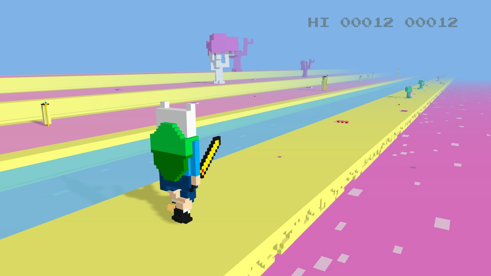
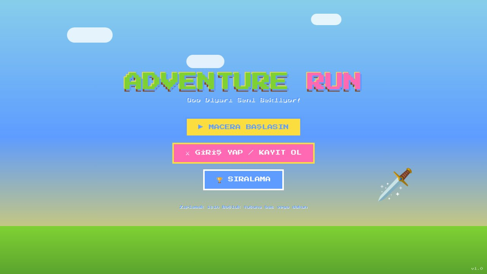

# Adventure Run

A browser-based 3D endless runner set in an Adventure Time–inspired world, built with **Three.js / WebGL** and a **Node.js + Express + SQLite** backend for accounts and a global leaderboard. No installation needed for players — it runs directly in the browser.



## Features

- **3D voxel graphics** rendered with Three.js and WebGL, with dynamic lighting and shadows
- **Endless runner gameplay**: jump and duck to avoid obstacles while the speed keeps increasing
- **User accounts**: register and log in (passwords hashed with bcrypt, sessions with JWT)
- **Global leaderboard**: every player's best score is saved to the database and ranked
- **Turkish UI** with a custom loading screen and main menu
- Keyboard and touch controls



## Tech Stack

| Layer    | Technologies |
|----------|--------------|
| Frontend | HTML5, CSS3, JavaScript (ES modules), Three.js, WebGL, Vite, Howler.js, vox.js |
| Backend  | Node.js, Express.js, SQLite, JWT (jsonwebtoken), bcryptjs |
| 3D Art   | MagicaVoxel (`.vox` models) |

## Project Structure

```
adventure_run/
├── backend/            # Express REST API
│   ├── server.js       # App entry point (port 3000)
│   ├── database.js     # SQLite connection + table setup
│   └── routes/
│       ├── auth.js     # POST /api/auth/register, POST /api/auth/login
│       └── scores.js   # POST /api/scores, GET /api/scores/leaderboard, GET /api/scores/max
├── frontend/           # Game client (Vite)
│   ├── index.html
│   ├── js/build.js     # Game code (managers for player, enemies, scores, UI, auth)
│   ├── objects/        # Voxel models (.vox)
│   ├── libs/           # Three.js, howler, vox.js, three-nebula
│   └── css/, media/, sound/, textures/
├── start.bat / start.sh      # Install dependencies and start both servers
└── install.bat / install.sh  # Install dependencies only
```

## Running Locally

Requirements: [Node.js](https://nodejs.org/) 18 or newer.

**Windows:** double-click `start.bat`

**macOS / Linux:**
```bash
bash start.sh
```

Or start each part manually:
```bash
cd backend && npm install && npm start      # API on http://localhost:3000
cd frontend && npm install && npm run dev   # Game on http://localhost:5173
```

When the game runs on `localhost`, it automatically talks to the local backend.

### Environment variables (backend)

| Variable     | Description |
|--------------|-------------|
| `PORT`       | API port (default `3000`) |
| `JWT_SECRET` | Secret used to sign login tokens. **Set this in production.** |

## API

| Method | Endpoint                  | Auth   | Description |
|--------|---------------------------|--------|-------------|
| POST   | `/api/auth/register`      | –      | Create an account (`username`, `password`) |
| POST   | `/api/auth/login`         | –      | Log in, returns a JWT |
| POST   | `/api/scores`             | Bearer | Save a score (kept only if it is a new personal best) |
| GET    | `/api/scores/leaderboard` | –      | Top 10 players by best score |
| GET    | `/api/scores/max`         | Bearer | Current player's best score |

## Credits

This project is built on top of the open-source **[dino3d](https://github.com/Priler/dino3d)** — a 3D remake of Google Chrome's T-Rex game by **Abraham Tugalov** (© 2020), licensed under GPL-3.0. Adventure Run extends it with a new theme and character, a Turkish user interface, user accounts, a backend API with a SQLite database and an online leaderboard.

Third-party libraries: [three.js](https://threejs.org/), [vox.js](https://github.com/daishihmr/vox.js/), [howler.js](https://github.com/goldfire/howler.js/), [three-nebula](https://github.com/creativelifeform/three-nebula), [visibly.js](https://github.com/addyosmani/visibly.js/). Voxel models were made with [MagicaVoxel](https://ephtracy.github.io/).

Adventure Time is a trademark of Cartoon Network. This is a non-commercial fan project and is not affiliated with or endorsed by Cartoon Network.

## License

Because it is based on a GPL-3.0 project, Adventure Run is also released under the **GNU General Public License v3.0** — see [LICENSE](LICENSE).

## Author

**Tuğba Öyküm Çoban** — [oykumcoban19@gmail.com](mailto:oykumcoban19@gmail.com)
